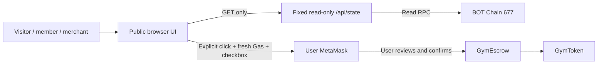

# 今天链不练 · BOT Chain Edition

A gym prepaid-credit escrow demo on **BOT Chain Mainnet (677)**. A merchant requests a session; only the member can confirm consumption. No cash value, token sale, faucet, custodial wallet, or server signer.

## 业务与体验

健身预付的痛点是余额、扣费与收款去向难以核对。本演示用 GymEscrow 记录会员托管额度、单次核销与商家已确认收入：

1. 会员先精确授权并充值（本项目已在主网完成 30 GYM）。
2. 商家用唯一课程标识发起 30 GYM 核销，有效 24 小时。
3. 会员确认才减少托管额度；可以拒绝，商家也可以撤销申请。
4. 商家只能提现已确认收入。会员可以退回未消费 GYM。

BOT Chain 提供真实交易签名、合约执行、不可由页面任意改写的额度与事件证据。普通 ERC-20 transfer 不会增加 GymEscrow 的会员额度。

访客无需钱包或资产即可查看主页、主网账目、当前核销申请、充值证据和 BOTScan。连接陌生钱包只提供只读角色提示，不要求购买 BOT/GYM。公开版没有领取、铸币、转账、部署、approve 或 deposit 入口。已完成的充值不会被重发。

## Mainnet contracts and evidence

| Item | Address / transaction |
|---|---|
| Network | BOT Chain Mainnet / 677 / native BOT |
| RPC | https://rpc.botchain.ai |
| GymToken | [0x93DFA83eddBf8A87b124fC27c8B1266e9E5F1AcA](https://scan.botchain.ai/address/0x93DFA83eddBf8A87b124fC27c8B1266e9E5F1AcA) |
| GymEscrow | [0xC0E8d8Ef388E79A4FB23B6391F66DC34C856Ef43](https://scan.botchain.ai/address/0xC0E8d8Ef388E79A4FB23B6391F66DC34C856Ef43) |
| Member | 0xb6bF6a936F529650992B71e2DeB79E80Fd3da71B |
| Merchant / initial payout | 0x89F415bb42e356E8b892C10B05522e0a8Ef151F3 |
| Real deposit(30) | [0x5b6f2465314abeb73e7770d12bb8af992ee530ac74f2859a62d79d533a3fab51](https://scan.botchain.ai/tx/0x5b6f2465314abeb73e7770d12bb8af992ee530ac74f2859a62d79d533a3fab51) |

GymToken: Gym Demo Credit / GYM / decimals **0** / fixed supply **300**. Initial allocation: member 300 GYM. Token constructor: `recipients=[member], amounts=[300]`. Escrow constructor: `(tokenAddress=GymToken above, merchantAddress=merchant above, initialPayout=merchant above)`.

Deposit independently verified on 2026-10-21: block **27425715**, nonce **1**, Receipt Success, exact calldata, canonical block inclusion, Deposited(member,30), Transfer(member,escrow,30). Gas **126515**, actual fee **0.00253030 BOT**. Historical post-deposit state: member270, escrow assets30, member credit30, totalUserCredit30, allowance0. Subsequent consumption/refund can change current balances; the UI always queries current state. `data/verified-deposit.json` is an explicitly historical, sanitized proof summary.

## Architecture



- `src/chain.mjs`: fixed-block real reads, deployed runtime hash matching, contract configuration/accounting checks, receipt/input/emitters/events/canonical inclusion checks. Incomplete RPC transaction fields may be supplemented from the matching full canonical block; conflicts fail closed.
- The expandable fund check explains the current escrow assets, member liabilities and merchant revenue from verified facts. It preserves the upstream fund-transparency concept without inventing AI investigations, external fund tracking or synthetic reports.
- `api/state.mjs`: GET only, no custom RPC/address/transaction input; only fixed read methods. No private key, wallet access, signing, arbitrary RPC proxy or broadcast endpoint. Server cache ≤15 seconds, errors return 503 without synthetic fallback.
- `src/wallet.mjs`: fixed roles/contracts/actions. Supports request, confirm, reject, cancel, refund30 and withdraw30. No token approve, deposit, deployment, payout change or arbitrary transaction functionality.
- Browser transaction previews expire after 60 seconds. Checks network/account/state/latest vs pending nonce/BOT balance/Gas again before explicit submission; fee cap uses 20% Gas margin. Each operation has its own human checkbox and MetaMask review. No automatic next transaction.
- LocalStorage keeps hash, nonce and pending/unknown/verified state; persist-before-submit and Web Locks prevent simultaneous tabs from sending. Unknown/reverted/unverifiable records stay locked for investigation. Read-only recovery validates the original input, nonce, receipt, event and current accounting. Never clear browser storage to bypass a lock; it is local protection, not a cross-device coordinator.
- `contracts/` contains unchanged auditable Solidity source (not deployment tools). No server signer or deployment bytecode is bundled into the public browser UI.

## Local run (Windows PowerShell)

Install Node.js **24.x**, then:

```powershell
# Run from the independently cloned public repository:
Set-Location .\jintian-lianbulian-bot
npm.cmd ci
npm.cmd test
npm.cmd run build
npm.cmd run audit:release
npm.cmd run preview
```

Open **http://127.0.0.1:8788/**. Stop this public preview with Ctrl+C. No environment variables or credentials are needed in normal operation. Local preview scripts bind only loopback; the Vercel API uses the public BOT RPC independently.

`npm.cmd run compile:contracts` independently compiles the unchanged public Solidity sources with solc0.8.30, optimizer200 and Shanghai EVM. Compilation never deploys anything; public tests compare ABI selectors/events with the compiler output. The private preparation workspace also retains its full isolated-EVM business tests and historical evidence.

Both preview and cloud use the fixed public RPC through the read-only HTTP transport. There are no dynamic local adapters, parent-workspace imports, private services or machine-specific paths. If a local network requires a proxy, configure the Node process's standard network environment outside the repository. RPC failure shows unavailable balances and disables business actions; it does not fabricate success. A successful local check does not replace checking the deployed Preview from Vercel's network.

## Wallet use

Use a current MetaMask-enabled Chrome/Edge (HTTPS in production, loopback allowed locally). Click **连接 MetaMask**, then explicitly switch/add BOT 677 if necessary. Connection alone never requests a signature. Member/merchant tabs only change the view, not wallet authority. Unknown addresses remain visitors. Only the designated wallet can preview its own role's actions.

MetaMask discovery supports EIP-6963 and legacy injected providers. After connection, the header shows the role and account; member/merchant account changes select the corresponding panel. Account, network, connect and disconnect events invalidate existing transaction previews immediately, and older asynchronous responses cannot restore a previous role or preview. Identity remains visible on the wrong network while business actions stay disabled. Adding BOT 677 is followed by an explicit switch and a fresh network check.

The public ledger always shows the designated demo member and merchant accounts; switching the connected wallet changes authority, not which accounts the public ledger describes. Role feedback is independent of ledger API availability. Each new Preview origin needs its own MetaMask site permission.

Before any future write, independently agree the business operation, inspect calldata/target/amount/network/Gas, tick the checkbox, click MetaMask review, then decide in MetaMask. Each request/confirm/refund/withdraw is a real mainnet action and changes the demonstration state. Do not perform any of them as part of publishing or testing. Automated tests use a fake wallet only.

## Stage1 release status

Public source: [HaoGe-emm/jintian-lianbulian-bot](https://github.com/HaoGe-emm/jintian-lianbulian-bot), branch `codex/preview`.

The public-source release is complete. A usable Vercel Preview is **not yet available**: during Stage1 the platform assigned initial deployment requests to Production despite the explicit Preview requests. Those deployments were withdrawn; no active deployment is retained. Further deployment attempts are stopped until a Preview-only method can be verified. Do not treat a build success or a removed deployment URL as a passed public Demo acceptance test.

Publish **only this independently initialized public repository**, under the user's approved Stage1 GitHub + Vercel Preview release. Do not publish the parent private project or its Git history, `work/`, journals, approval files, recovery tools, reports, private build manifests or deployment endpoints. `.gitignore`, `.vercelignore` and the release audit limit the release surface. The public repository has a fresh history independent of the private parent workspace.

Vercel configuration is in `vercel.json`: Framework Other (`null`), Node24, install `npm ci`, build `npm run build`, output `dist`, fixed read-only Node function `/api/state`. No secrets/env vars. Import the future release repository root (or select `public-demo` explicitly if using a carefully sanitized monorepo). Review the actual file list before pushing. Do not use the private project root as Vercel Root Directory.

Stage1 authorizes GitHub publication and Vercel Preview only. Do not connect automatic Git Production deployment or run a Production deployment. The Vercel remote build, RPC reachability, public HTTPS, MetaMask injection, cache/security headers and mobile experience must be checked on the actual Preview. Real MetaMask interaction is reserved for the project holder. Production and custom domains require a separate later approval.

## Limits and security

- GYM has **no cash value**. Not redeemable for fiat or BOT; BOT Gas is real. No audited production-funds guarantee or offline service guarantee.
- Card valid365 days from first deposit; later deposits do not extend it. A request does not reserve credit; refund may make confirmation impossible. Merchant request is not a deduction.
- Mainnet credit is only30, enough for one demonstrated session. After confirmation/withdrawal or refund, figures change. There is no unlimited judge faucet.
- The fixed showcase member's balance is public blockchain data. Do not place names/phone numbers/personal details in course identifiers; hashes do not guarantee privacy.
- RPC availability and honesty are external dependencies. This app checks canonical consistency on the configured RPC, not a multi-provider consensus or professional audit. Chain reorganizations may temporarily disable verification.
- Browser records do not survive data deletion or coordinate other devices. Never retry uncertain transactions; inspect wallet/BOTScan and recover the existing hash.
- No backend stores wallet secrets. No analytics, AI service keys, database or external images/fonts are required.
- The compilation-only dependency `tmp` is overridden to **0.2.7** to address [the maintainer's reviewed advisory](https://github.com/advisories/GHSA-7c78-jf6q-g5cm). solc remains0.8.30; no Solidity or deployed logic was changed. Runtime and full lockfile audit results are recorded privately with the release preparation report.

## Attribution and permissions

Original author **efrwww**, upstream [jfefrgv](https://github.com/efrwww/jfefrgv), pinned commit `1841e8005d3e87e35fdfcdfb44f215782105ea3e`. Preserve [NOTICE.md](NOTICE.md) and [THIRD_PARTY_NOTICES.md](THIRD_PARTY_NOTICES.md).

The author has permitted this project's adapted-source publication on GitHub and website deployment on Vercel, with original author attribution retained. This does not grant third parties unrestricted redistribution, commercial use or relicensing. No project-wide license has been invented; existing contract MIT SPDX and dependency licenses retain their own scope. No upstream images have been copied. Private authorization communications are not included in this repository.

See [ACCEPTANCE.md](ACCEPTANCE.md) for the seven-item readiness checklist.
